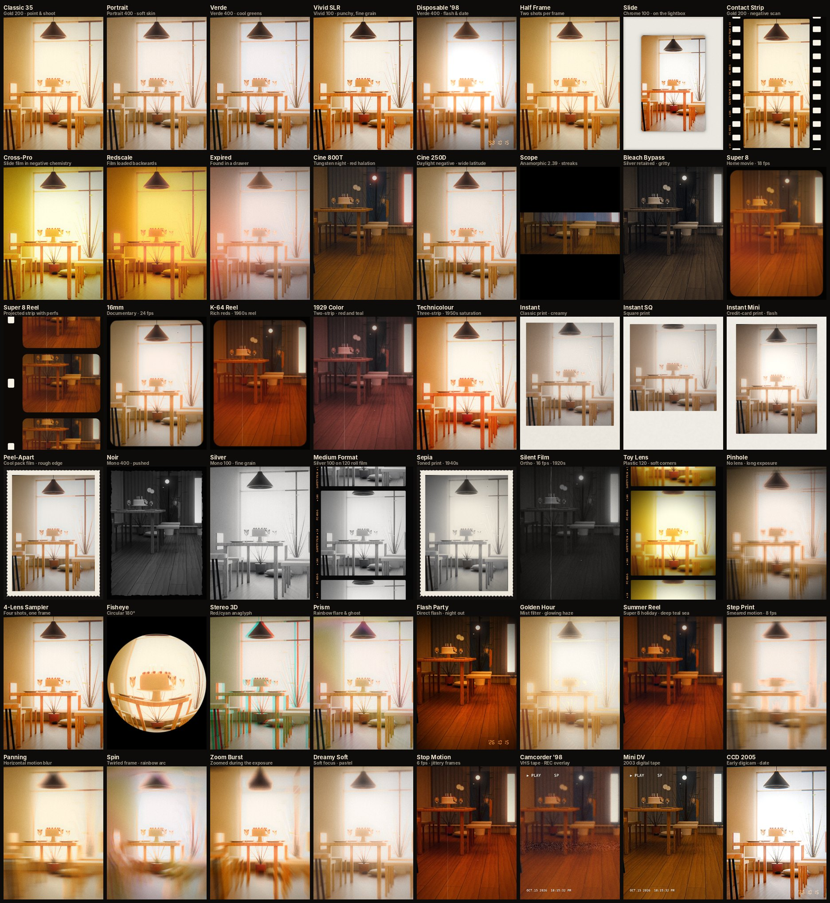
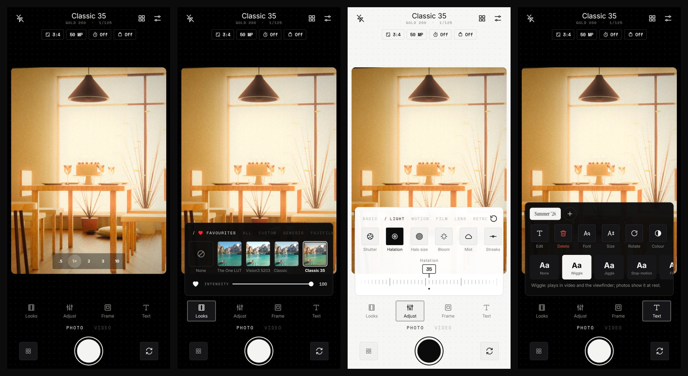
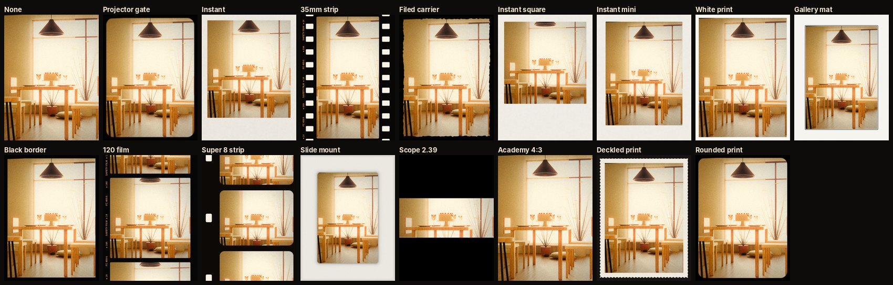

# S film (Android)

*Formerly SavioCam and FilmCam.* The app is called **S film** on the phone, with its own icon:
a bold geometric S in a white square, with a thin + in its upper counter, on black (a vector
adaptive icon, with a monochrome layer for themed icons). New photos and clips go to
`Pictures/S film` and `Movies/S film`. The gallery still shows everything saved under the old
`SavioCam` and `FilmCam` albums.
The package id stays `app.filmcam`, so it installs over the old app and keeps its settings,
favourites and imported looks.

A camera app that is first a normal phone camera and then, one tap away, a film camera.
**Original** shows the phone's own picture, with iPhone-style photographic styles. A **look**
puts it through a live film emulsion. It shoots at the phone's full resolution: 720p to 8K
video, 12/50/200 MP stills where the sensor offers them, RAW (DNG), and every lens on the phone.
What you see in the viewfinder is what gets saved, borders included. It also records 10-bit
log video for grading, and develops photos and clips taken with any other camera.

The look definitions and shaders are shared with the iOS app ([`../filmcam-ios`](../filmcam-ios), install it with
[INSTALL.md](../filmcam-ios/INSTALL.md)) through
[`../filmcam-shared`](../filmcam-shared) (see [the porting guide](../filmcam-shared/PORTING-iOS.md)).



*Original plus all 64 looks, rendered through the app's real shaders by `tools/look-preview`.
Preview photo: Pietro De Grandi on Unsplash (Unsplash Licence).*

## The app



The interface stays out of the picture. It's styled like a modern editor: black (or white)
panels with hairline borders, nearly square corners, Inter for text and Space Mono for labels
and values, with section heads written `/ LIKE THIS`. No colour of its own: the picture is the
colour.
- **Motion:** every tap gets a gentle press (the control sinks to 96% and springs back); trays,
  panels, pages, messages and the look title slide and fade in and out; selections ease between
  states. All of it is drawn in the draw phase or by Compose's own animations, so it costs no
  extra layout and the app stays light.
- **Top bar:** flash, the camera name (the look, or *Original*), the gallery and the settings
  button.
- **Chips under it:** the frame shape (`3:4`), photo size (`50 MP`) or video format (`4K · 30`),
  log, the self-timer and bursts. Each opens a small panel over the top of the picture.
- **Viewfinder:** the shape of the saved frame, with glass zoom pills (`.5  1×  2  3  10`).
- **Focus and exposure, as in a phone's own camera:** tap to focus and meter there; a box and a
  sun on a short line appear beside it. Then drag up or down anywhere on the picture to brighten
  or darken (the value shows next to the sun). They fade a few seconds after the last touch; a
  new tap meters afresh. Pinch to zoom.
- **Dock:** four items above the shutter (*Looks*, *Adjust*, *Frame* and *Text*). Each one opens
  a single tray, never a long panel.
- **Looks:** *Favourites*, *All*, then each category (Custom, Genesis, Fujifilm and the rest).
  With a look on, a heart keeps it in Favourites and an **intensity** slider sits right under
  the looks (from none of the look to all of it).
- **Adjust:** pick a group, then a tool, and drag the ruler. *Basic* holds the everyday
  corrections on top of any look or the Original camera: Exposure, Strength (how much of the
  look's colour), Temp, Tint, Contrast, Highlights, Shadows, Saturation, Vibrance, Clarity,
  Sharpness and Fade. Then come Light, Motion, Film, Lens and Retro. Turning on a blur in
  Motion starts gentle: 25% strength with a 75% sharp centre.
  - **Your values stay.** Whatever you set in Adjust (grain, halation, bloom...) carries over
    when you change looks, until you set it back to the look's own value or tap reset.
  While you drag, everything else fades away so you can judge the picture; only the ruler and
  its value stay. Double-tap the ruler to go back to the camera's own setting. A dot marks the
  tools you've changed.
- **Closing:** a tap anywhere outside an open tray or panel closes it.
- **Sounds:** the shutter click and the recording beeps can be turned off in settings, except in
  countries whose law requires them; the app asks Android.
- **Themes:** dark by default, light, or follow the system; both sit on a fine dot grid.
- **Gallery and viewer:** swipe left and right through every take. *Shot with* at the top names
  the look each photo or clip was made with; tap it to put that look on the camera.
- **Grain:** every look starts with the same faint, fine grain (0.05; it was 0.14, which read
  as noise next to the system camera). Turn it up per shot in *Adjust*. Original has none.

## Original

The app opens as a plain phone camera: **Original**, with nothing applied. It shows the camera's
own picture through the same stream the system camera app uses. Phones keep some of their
processing (Samsung's scene optimiser, multi-frame HDR) for their own app, so photos can differ
slightly from it. (The photographic *Styles* tab has been removed; the looks cover it.)

## Text overlays

Burn text into video while you record, and into photos.
- **Fonts:** bundled fonts (Inter and Inter Bold, Inter Tight, Instrument Serif and its italic, DM Serif, Playfair, Bebas,
  Space Mono, a typewriter, a VHS face, a handwritten one, Montserrat, Poppins, Oswald, Anton,
  Archivo Black, Nunito, Rubik, Lora, Bangers, Righteous, Lobster and Pacifico), twenty Telugu
  faces (Noto Sans and Serif Telugu, Hind Guntur, Anek Telugu, Baloo Tammudu, Ramabhadra,
  Mandali, Gurajada, Tenali Ramakrishna, NTR, Suravaram, Ponnala, Mallanna, Gidugu, Dhurjati,
  Timmana, Sree Krushnadevaraya, Peddana, Lakki Reddy), the system fonts, and any
  `.ttf`/`.otf` you import. All bundled fonts are under the SIL Open Font Licence
  (`assets/fonts/licenses`).
  - **By family.** The picker shows one tile per family, with how many styles it has. The
    chosen family's weights and styles show as a row under it. Variable fonts offer every named
    instance they carry, so Inter Tight has Thin to Black.
  - **Import** takes several font files at once, or a `.zip` of a font folder (every .ttf, .otf
    or .ttc inside, in any folder). Each file's own name table gives its family and style, so
    a whole family arrives grouped as one.
- **New text** starts in the middle of the frame, with no shadow.
- **On the viewfinder:** drag a text to move it (it snaps to the centre lines, with guides), pinch
  to resize, twist to rotate (it snaps to level and to 90°), and double-tap to retype. The red ×
  on the selected text deletes it; so does *Delete* in the tray.
- **In the tray:** size, rotation, opacity, letter spacing, line spacing, colour (33 swatches,
  plus a spectrum and a lightness bar for any other colour), shadow (off by default),
  left/centre/right alignment, and a 3×3 placement grid.
- **Animate:** text can move in video and the viewfinder: *Wiggle*, *Jiggle* and *Stop-motion*
  (held poses, 12 or 8 a second, as if moved by hand between shots), *Float*, *Swing*,
  *Bounce*, *Pulse*, *Spin*, *Flicker* and *Typewriter*. Each tile in the picker previews its
  own movement. Photos show the text at rest. Poses follow the clip's own clock, so an export
  matches what the viewfinder showed; the overlay is only redrawn when the pose changes (and
  at 1280 px instead of 2048 while animating).
- **Placement:** text is laid out in the upright frame, so it stays put when you turn the phone,
  and it sits above borders (a caption on an instant print works).
- **Behind the subject (Depth):** set a text *Behind subject* and the subject passes in front of
  it, live in the viewfinder, in video while you record, and in photos.
  - **What the subject is:** by default every person in the frame. With the Depth tool open, tap
    something in the picture to make that the subject: a person, a pet, a horse with its rider,
    a car, a bike. *All people* goes back to the default. While a text is set *Behind*, a tap
    anywhere in the picture picks the subject (it does not select or move texts).
  - **What it's doing:** a line under the Depth controls says what the cut-out is doing
    ("Cutting out people", "No person in view", "Subject out of view") or why it couldn't
    start, so a text that isn't going behind anything is never silent about it.
  - **How it's cut out:** each frame is segmented on the phone, with no network. DeepLab v3
    finds people, animals and vehicles; around people, MediaPipe's selfie model draws their
    edge. A picked subject is followed frame to frame by its outline, so it stays the subject as
    it moves, and someone walking past it is not.
  - **Close to the subject, firm round hair:** the text is cut at the person's own edge, so it
    sits right against a face, an ear or a shoulder. Only where there is hair is the cut-out
    firmed up: MediaPipe's multiclass selfie model (every third frame) finds the hair, and there
    faint strands count as subject, the zone grows by about 1% of the frame and is held for a
    few frames as it fades, so flyaway or moving hair never lets text peep through. No hair
    (or no hair model) means no margin anywhere.
  - **Timing:** segmentation runs alongside the film passes. The frame waits up to 12 ms for
    its own cut-out, so a moving subject and its cut-out stay together. If the model is slower
    on a phone, the cut-out lands one frame later. Photos wait for their own cut-out.
  - **On the CPU:** the models run on the phone's CPU (XNNPACK), at 256 pixels on the long
    side. MediaPipe's GPU delegate is not used: on phones where it can't start, its GL thread
    takes the whole app down a few seconds later.

## Subtitles

After a clip is shot, open it and tap **Subtitles** (or, after a take with live subtitles,
tap *Edit live subtitles* on the camera screen).

**Laid out for a phone.** The clip takes all the room there is, with a slim play bar under it
(play/pause, time, scrubber) and *Burn in* at the top right. The tools run along the bottom:
Lines, Style, Text, Effects, Motion, Words (kinetic) or Position (Classic), Sound and More.
Each tool opens one short panel over the rail. Tapping it again closes the panel, and the clip
grows back. Lines gets a taller panel, because you type in it.
- **Generate:** the clip's speech is written out as timed subtitle lines, in English and in
  Telugu (Telugu script). It handles speech in either language, and Telugu with English words
  mixed in. The language spoken in most lines decides which one shows first.
  - *Or write them yourself* starts with an empty line, with no transcription at all.
- **Lines:** every line, in order of time, with a text field for each language, so you can
  retype a wrong word.
  - *Start* and *End*: − / + move them by a tenth of a second (hold to keep going), *Now*
    sets them to the playhead, and tapping a time jumps there.
  - Delete a line, or *+ Add a line* at the playhead.
- **Words land on the voice.** Every word of a line is timed to the clip's sound, so a kinetic
  caption appears as the word is said, not spread evenly across the line. See *Word timing*
  below. While it works, *Timing each word to the voice…* shows under the clip.
- **Style:** the template first, then the language: English, తెలుగు or Both (stacked: Telugu
  above English).
  - **Templates.** *Classic* shows a line at a time. The other three are kinetic captions,
    modelled on podcast and talking-head reels. Each word comes in as it is said, revealed
    left to right out of a soft blur in about a quarter of a second. Words are grouped into
    short phrases the way an editor would cut them: a quotation stands alone, a phrase closes
    on its key word, and "struggles with?" stays together. Each phrase is replaced whole by
    the next.
    - *Scatter* (the default for new subtitles) sets each phrase like a small poster. The word
      that carries the meaning is big, and the small words sit tight on its shoulder. Phrases
      jump between the top corners, beside the head, the chest and lower down, never the same
      spot twice running.
    - *Stack* builds up to three lines in the middle, mixing Inter Tight, the serif and the
      italic.
    - *Focus* shows one or two words at a time, centred.
    - *Sides* stacks the words down the left and right edges, alternating sides, with the key
      word bigger. The middle stays clear for a centred subject.
    - *Cascade* steps each phrase down diagonally, word by word, alternating direction.
    - *Highlight* shows the whole line low in the frame. Words not yet said are dim, the word
      being said is in a highlight colour (yellow by default, set in Text) and pops a little,
      and words already said are white.
    - *Lower third* builds lines low on the left, with the key word in the serif.
    - *Headline* sets big capitals across the top of the frame.
    - *Punch* shows one huge word at a time, with a small word above it if it has one.
    The face is Inter Tight Bold, with Instrument Serif Italic for the odd accent word. New
    captions have no shadow; add one in Effects.
  - **Text behind subject** (kinetic templates) sends some of the big words behind the
    person: about two phrases in five, never all of them, and never the small words. Those
    words are set wide across the top of the head, so the hair hides part of them and both
    ends still show. The editor's preview shows them faded, because it has no cut-out. The
    burnt-in clip cuts the person out of every frame and puts those words behind them.
    - **The cut-out is firm.** Uncertain edges (hair, a busy background) count as the subject,
      the outline is grown by about 1% of the frame, and the last frame's subject is held
      faintly. Words don't show through a moving head or moving hair.
  - **Blend modes** (Effects): normal, screen, add, overlay, soft light, multiply, difference or
    colour dodge mix the words with the picture under them. The preview plays the clip on a
    texture so it blends exactly as the burnt-in clip, where the film shader does the same
    maths.
  - *Shuffle layout* (in Style) picks other spots and accents. *Original* goes back to the
    first layout.
- **Text:** size and letter spacing on sliders, text colour, and the fonts. Kinetic captions
  have main, accent and (for Stack) italic fonts; Classic has one font for English and one for
  Telugu. Each font drop-down shows every font in its own face, and a font only appears where
  it has that script's letters.
- **Effects:** for kinetic captions, a finish on the letters to help them read over a busy
  picture: none, soft shadow (the default), drop shadow, glow, soft blur, outline or haze (a
  dark, diffuse cloud behind the words). Each is shown on a little tile, with a strength
  slider and a colour (*Auto* uses the effect's own). For Classic lines: none, shadow,
  outline or box, with the outline or box colour and the box's opacity.
- **Motion** (kinetic): how words come in (blur, fade, rise, pop, type or cut), and *Text
  behind subject*.
- **Sound:** *Reduce background noise* when burning in: Off, Light, Medium or Strong. See
  *Background noise* below.
- **Words** (kinetic templates): tap any word on the video to pick it, or pick it from the
  phrase's words below the video. ‹ and › step through phrases, holding the clip on each.
  Drag a word to put it anywhere; the centre line snaps. A picked word can change its font
  (Sans, Italic, Serif or any font), its size, its colour, how it comes in, and its depth:
  Auto, In front or Behind. *Reset word* undoes that word's changes, and *Undo N word changes*
  in Style undoes them all. Changes are kept with the clip. A change is dropped if you retype
  that word.
- **Position** (Classic): drag the subtitles on the video to put them anywhere (the centre snaps, and
  thirds guides show while placing), or tap one of nine spots: top, middle or bottom by left,
  centre or right. *Line up* sets left, centre or right alignment. The block always stays
  inside the frame.
- **More:** full-screen preview, *Redo with Gemini*, *Save .srt*, and undoing word changes.
- **Preview:** the full-screen button plays the clip full screen with its subtitles, with
  play/pause and a scrubber, and *Burn into video* right there.
- **Save:**
  - *Burn in* saves a copy of the clip with the subtitles in the picture. The original sound
    is copied untouched (unless *Reduce background noise* is on), and the picture goes through
    the plain Original look, so no grain or
    grading is added. Portrait clips stay portrait (the decoder already stands them upright,
    so the engine doesn't turn them again).
  - *.srt* writes a subtitle file to Downloads.
  - Edits are kept with the clip until you come back.
  - The preview over the clip is drawn by the same code that burns them in.
- **How it's transcribed:**
  - The clip's sound (copied as AAC, or converted to 16 kHz WAV) goes to Google's Gemini API
    with your own key. It is free from aistudio.google.com/apikey; enter it with the key icon.
  - Gemini returns timed cues in a fixed JSON form. Clips with more than about 13 MB of
    sound are uploaded through Gemini's Files API.
  - The model can be changed next to the key (default `gemini-3.8-flash`).
  - Only the sound is sent, and only when you tap Generate.
  - The answer streams in: the screen shows the time so far and how many lines have come
    back, and *Cancel* stops it. *Fast* picks a lighter model (`gemini-3.5-flash-lite`) that
    answers in a few seconds; *Best* is the default.
- **Live, while you speak:** in video mode, the **CC** pill at the top left turns live
  subtitles on and off, and the chip next to it picks English or తెలుగు. While you record,
  what is said shows on screen as it is heard (not in the video), with what the recogniser is
  doing next to the pill (*Listening*, *Hearing you*, or what went wrong). You can turn it on
  or off mid-clip.
  - When the take ends, the lines are kept with the clip, timed to it. *Edit live subtitles*
    opens them in the editor above to fix, style and place before burning them in.
  - It uses the phone's own speech recogniser (Google's where installed), fed the same
    microphone sound the clip records at 16 kHz, so it never takes the mic from the video.
    It works with every video setting, 10-bit HLG included.
  - It needs Android 13 or newer and Google's speech services. Telugu usually needs an
    internet connection; English works offline on many phones. If a language isn't
    available, the app says so.

## Word timing

Gemini gives each line a start and an end, but not each word. Spreading the words evenly over
the line put some on screen before they were said and some after. Now every word is found in
the sound.
- **The model:** a small acoustic model on the phone (335 thousand weights, 0.7 MB). It reads
  40 mel bands every 10 ms and gives the probability of each letter every 20 ms. It was
  distilled from Meta's MMS forced aligner (300 million weights) on 3 hours of speech:
  LibriSpeech, People's Speech (real-world recordings) and FLEURS Telugu. The training audio
  had added noise (hiss, rumble, mains hum, chatter) and level and tone changes, so phone
  recordings in a room work too.
- **Matching the words:** each line's words are spelt in Latin letters (Telugu by sound, using
  the same rules as the model's training; numbers in words). They are then forced through the
  letter probabilities (CTC Viterbi), only near where Gemini put the line. "Anything else" is
  allowed before and after, so a line time that is off by a second, or speech nobody wrote
  down, doesn't drag the words.
- **When it runs:** right after subtitles are made, when a saved clip without times opens, and
  half a second after a line is retyped. The sound is analysed once per clip; re-timing a
  retyped line takes milliseconds. A line shown as a translation (Telugu speech with English
  captions) can't be matched word for word, so it keeps the even spread.
- **Measured** against hand-checked word times, on clips the model never trained on, with
  Gemini-like line times off by up to 0.3 s:
  | Speech | Within 0.1 s, before | Within 0.1 s, now | Within 0.2 s, now |
  |---|---|---|---|
  | English read aloud (LibriSpeech, hand-checked times) | 31% | 92% | 96% |
  | Real-world English recordings (People's Speech) | 35% | 89% | 92% |
  | Telugu (FLEURS) | 37% | 96% | 97% |

  The People's Speech and Telugu reference times come from the large MMS aligner itself, so
  those rows show how closely the small model follows it. The LibriSpeech row is checked
  against independent forced alignments. With exact line times, the median error is 10–25 ms.
  A 10 s clip is analysed in about a quarter of a second on a desktop JVM. `WordAlignerTest`
  checks that the phone's model gives the same probabilities as the training code (largest
  difference 0.0003).
- **On screen:** a timed word starts coming in 60 ms before it is said, so it is forming as it
  is heard.
- **Licence:** because the model learnt from MMS (CC-BY-NC 4.0), its weights carry the same
  non-commercial terms. Training audio: LibriSpeech (CC-BY 4.0), People's Speech (CC-BY /
  CC-BY-SA) and FLEURS (CC-BY 4.0).

## Background noise

*Reduce background noise* (camera settings, for video) cleans the sound as it is recorded.
*Sound* in the subtitle editor does the same to a clip when you burn it in.
- **How:** RNNoise (Xiph / Mozilla, BSD licence), ported to Kotlin. A small recurrent
  network sets a gain for each of 22 frequency bands every 10 ms, and a pitch filter keeps
  the voice's harmonics. The port's output is identical, sample for sample, to the C code
  (`RnNoiseTest`). It runs at about 50× real time.
- **The voice stays natural.** The network also says how likely each moment is to be speech.
  While someone speaks, only part of the cleaned sound is used and the rest is the original
  (65% cleaned at Medium); in pauses it is fully cleaned. The blend follows the voice
  smoothly, with no clicks.
- **Measured on speech mixed with noise** (Medium, 10–20 dB below the voice):
  - Steady noise (hiss, pink noise, mains hum, traffic rumble) is 14–26 dB quieter in pauses.
  - Intelligibility (STOI) changes by less than 0.01 either way.
  - Background chatter drops by only about 5 dB, because the model treats it as voice.
- **Latency:** about 70 ms, which the recorder takes back out, so sound and picture stay in
  sync.

## Custom looks

The **Custom** tab holds creators' grades and your own LUTs.
- **Sleepy Charlie:** the look of Sleepy Charlie's *Cinecell 02* film-emulation PowerGrade
  (sleepycharlie.com): dense colour, cream-amber highlights, lifted navy blacks, fine grain
  and an orange halo round lights.
  - **How it was made:** the creator publishes eight frames as plain Rec.709 and graded.
    Every pixel pair says where one colour goes, so `tools/film-lab/customlab.py` fits a
    33³ LUT to all of them (smooth, with a bounded fallback for colours the frames never
    show). Grain and halation were measured from the same frames; there is no vignette.
  - **How close:** each frame predicted from a fit to the other seven lands at a median
    colour error of about 2.5 (OKLab ΔE×100; around 2 is barely visible), against 6.2 for
    the ungraded frame. It is not exact: the PowerGrade also adjusts exposure and white
    balance per shot, and its own LUT files aren't public.
- **Dehancer 250D / Dehancer 500T:** the look of Dehancer Pro (dehancer.com), the film
  emulation plugin, on its default stock (Kodak Vision3 250D daylight) and on Vision3 500T
  tungsten printed with grain and bloom.
  - **Colour:** fitted to Dehancer's own before/after frames: the plugin screenshot that shows
    one frame with only the camera input converted and with the 250D profile, and the Film
    Developer article's Rec.709 source and finished 500T frame. These are single portraits,
    so the film lab's cine stocks (250D-like and 500T-like) fill in the colours they don't
    show, moved by smooth curves toward what Dehancer does differently.
  - **How close:** within the frames, about 0.4 (250D) and 0.8 (500T) median ΔE against
    Dehancer's output, from 2.1 and 6.0 untouched. Outside skin, blues and browns it is the
    film model's estimate, not a measurement.
  - **Effects:** matched by rendering Dehancer's own None / Halation / Bloom / Grain frames
    through the app's shaders: grain 0.4 equals its default 35 mm ISO 250 grain; its halation
    is redder and stronger than film's usual orange (this look uses a redder halo near the
    top of the range); its bloom is a wide, low-threshold glow, which the app's diffusion
    reproduces.
- **Noah's Nostalgia:** the look of Noah Sandvik's travel films (YouTube, Noah's Nostalgia).
  He sells no LUT and names no grading tools, so it is learned from his own footage: the
  frames YouTube captures inside 30 of his videos (90 frames), measured against ungraded
  Rec.709 frames of similar subjects (`tools/film-lab/stylelab.py`).
  - **What it does** (each measured on his footage): skin goes golden (hue 56° → 67° in
    OKLab, a little richer), blue skies turn teal (243° → 208°), foliage goes darker and
    olive-teal with less saturation, reds are muted, mid-tones sit lower, shadows lean
    olive-green and highlights cream. The graded references land within a few degrees and a
    few percent of his footage on skin, foliage, sky and the tone curve.
  - **Texture:** a soft warm glow round highlights, light bloom and diffusion, fine grain and a
    mild vignette, as in his frames.
  - It is learned, not copied: there is no before/after of his to fit, so it captures his
    look's direction and strength, not any one shot's exact grade.
- **On The Run / On The Run Teal:** Nolan On The Run's grade (nolanontherun.com). He sells it
  as a Resolve PowerGrade and a LUT pack (Kodak 2383 / Fuji print emulation, 16 mm grain,
  halation, vignette, made for Sony S-Log3). His shop shows seven split frames, his grade
  beside the S-Log3 original, plus six more graded frames (`tools/film-lab/nolanlab.py`).
  - **How it's measured:** the two sides of each split are different moments, so there is no
    pixel pair to fit. The log side is decoded (S-Log3, S-Gamut3.Cine → Rec.709, a filmic
    display curve) into what a phone would show, and both sides are pooled and compared on
    skin, sky, foliage, warm highlights, the tone scale and its tint.
  - **What it does:** skies turn from blue toward teal-cyan (242° → 211° in OKLab), warm
    highlights go golden (96° → 81°, richer), skin goes a little richer and redder, foliage
    goes olive and darker, mid-tones sit lower (median L 0.59 → 0.47) with soft, rolled-off
    highlights, near-neutrals go quieter while vivid colours get stronger, and the top of
    the scale goes strongly warm.
  - **Two looks:** his frames aren't one grade. Most are golden and hazy (dunes, the Tetons,
    fields at dusk): *On The Run* (warmer balance, peach highlights, pale skies). One is
    orange and teal with a cyan sky: *On The Run Teal*.
  - **Texture:** halation, light bloom, 16 mm-sized grain and a mild vignette, as in his
    PowerGrade.
  - **Exactly his:** his LUT files (Rec.709 versions for phones are in his pack) import as
    they are through Import LUT below; these two looks are the measured approximation.
- **The One LUT:** the ARRI Alexa look of The One LUT (onelut.io), which turns iPhone Apple Log
  into Rec.709 "matched to ARRI's official Alexa K1S1 Rec 709 LUT"
  (`tools/film-lab/onelutlab.py`).
  - **Measured from its own frame:** the site shows one frame both as the Apple Log recording
    and through the LUT, pixel for pixel. Apple publishes the Apple Log curve, so the log side
    is decoded to the scene light it recorded, and the LUT is fitted to what it does to that
    light, first as an ARRI-style rendering (a matrix, ARRI LogC3, one S-curve per channel:
    how K1S1 itself is built, so it holds for colours the frame doesn't show), then refined
    on the frame's own pixels. On the half of the frame left out of the fit it lands at a
    median ΔE of 0.48 (0.67 for the ARRI-style rendering alone); below about 1 is
    invisible.
  - **On a phone picture:** the phone's picture is taken back to scene light (the inverse of
    a filmic display curve with 18% grey kept at 18%), then rendered through the fitted LUT.
    Two things the frame can't say are set as K1S1 sets them: the published frame was
    brightened before the LUT (it's a dusk shot), so exposure is anchored with the phone's
    18% grey at 0.43; and its dusk white balance is taken out so greys stay grey. The result
    is softer contrast, a long highlight roll-off (phone white still reaches 0.98), gentler
    saturation and natural skin.
  - **No texture added:** an Alexa image has no grain, halation or vignette.
  - **Exactly theirs:** their .cube is made for Apple Log footage; it imports through Import
    LUT, but it expects log, not a phone's normal picture.
- **Any plugin's looks, exactly (Hald image):** Import LUT also takes a *Hald CLUT* image:
  `tools/hald/hald-identity-512.png` (every colour, 64 steps per channel) put through a grade
  and saved as PNG. That captures any look you can run, exactly: every FilmBox look (Video
  Village publishes no per-look before/after frames, so they can't be fitted the way the
  looks above were), every Dehancer stock, Lightroom presets. Step by step for FilmBox in
  Resolve: `tools/hald/README.md`. Images that aren't a Hald size are refused with what's
  wrong, and a watermark or text on the image is detected and reported.
- **Import LUT (.cube):** the last card in Custom adds any 3D `.cube` LUT as a look: one you
  bought (Cinecell 02's Look LUT gives its colour exactly), or your own grade from Resolve,
  Premiere or Lightroom. It is resampled to the app's 33³ LUT and applied to the picture as
  it comes from the phone (Rec.709 / sRGB), live, in video and photos. Any size and
  `DOMAIN_MIN`/`DOMAIN_MAX` are read; 1D LUTs aren't. The selected imported look has a ×
  to remove it.

## Studio looks

The photo editor's own looks, in five tabs that follow its shelves: **Studio Film** (21:
Film, Gold 200, Portrait 400, Tungsten 800, Super 8, Cinema, Light leak...), **Studio Colour**
(Vivid, Warm, Cool, Fade, Dreamy, Punch), **Studio B&W** (B&W, Pan 400, Soft B&W, Noir, Sepia,
Xerox), **Studio Print** (Halftone, Fine dots, Duo blue, Duo pink, Duo dots, Photocopy, Riso)
and **Studio FX** (Motion, Gym grit, Ghost, Noise, Haze, Zoom burst, Spin, Tilt-shift, Double,
Fisheye, Lens). The editor's Original is the app's own Original.

- **Colour:** each look's colour and tone (exposure, contrast, highlights, split tone, cross
  process, duotone...) is the editor's own maths, baked into the look's LUT
  (`tools/studio-looks/studiolab.py`; within half a level of the editor's `.cube` files).
- **Everything else is drawn the editor's way** (`FilmLook.studio`): grain laid on with an
  overlay blend, its vignette, bloom and two-halo halation from the graded picture, its light
  leak, dust and scratches, fringing, sharpening and clarity, motion / zoom / spin blurs,
  double exposure, tilt-shift, fisheye, halftone dots, two-tone threshold and digital noise.
  Every size is a share of the frame, so the viewfinder, a 4K video and a 200 MP photo look
  the same. Grain, noise, leak and dust move from frame to frame in video.
- **Checked against the editor:** rendered through the app's shaders by `tools/look-preview`
  and compared with the editor's own renders of the same photo: 40 dB and up (no visible
  difference) for the colour, film and B&W looks; the blur and dot looks differ only where the
  editor averages its copies in 8 bits, as its own GPU version does.
- **Adjust works on them:** grain, vignette, halation, bloom, leaks, dust, fringing, sharpness,
  clarity, fisheye and the blurs change the look's own effects; the Basic tools go on top.

## Genesis

A tab of its own (**Looks → Genesis**) with the film stocks of *Genesis*, Cullen Kelly's film
emulation for DaVinci Resolve (made with film chemist Dr. Mitch Bogdanowicz and
cinematographer Steve Yedlin). One look per stock its page shows:

- **Kodak negatives** (each with the print Genesis pairs it with): Vision3 5203 + 2383,
  Vision2 5229 + 2393, Vision 5279 + 2383, EXR 5287 + 5386, ECN-II 5247 + 5384, ECN-I
  5248 + 5382.
- **Fujifilm negatives:** Eterna Vivid 8547 + 3523, Super-F 8532 + 3513, Reala 8592 + 3523,
  Fujicolor-A 8518 + 3523.
- **Kodak prints:** 2383, 2393, 5386, 5384 (1992), 5380, 5384 (1982), 5381 (1972), 5385 (1962),
  5382 (1952), 5381 (1950).
- **Fujifilm prints:** Eterna-CP 3523XD, 3513.
- **Bleach Bypass**, Genesis's lab process.

How it's made (`tools/film-lab/genesislab.py`):
- **Colour:** cullenkellycolor.com/genesis shows each stock on a before/after slider: one frame
  as Genesis's *Base* rendering and the same frame through the stock. The two are
  pixel-aligned, so each look's LUT is fitted to its pair the way the Custom looks are. A
  single frame holds only its own colours, so the fit leans, where its frame says nothing,
  on a lattice fitted to all 22 stocks' frames pooled (the density, tone and colour
  separation Genesis's stocks share), moved toward what this stock does differently.
- **How close:** each half of each frame, predicted from a fit to the other half (with the
  prior pooled from the other stocks only), lands at a median ΔE of 0.26–0.59 (0.44 on
  average) from Genesis's own frame, against 1.2–6.6 (3.4 on average) for the untouched Base
  frame; below about 1 is invisible.
- **Texture:** Genesis's default 35 mm grain, measured from its Base / 35 mm frames (grain
  0.3 here), and its gentle halation ("felt, not seen"), plus a touch of bloom. Adjust them
  per shot under Looks → Adjust.
- **What it can't know:** Genesis models the whole film process from the camera's log, with
  printer lights, push/pull and per-stock exposure behaviour. These looks start from the
  phone's finished picture and reproduce each stock's colour as Genesis rendered it on its
  sample frame; colours far from anything in the frames come from the pooled fit. Genesis's
  own LUT export (Indie and Pro) is the exact answer: export a 33-point Rec.709 LUT and
  bring it in with Looks → Custom → Import LUT.

## Fujifilm simulations and recipes

The first two groups develop the picture the way a Fujifilm camera makes a JPEG, from
Fujifilm's own data rather than an imitation:

| Group | Looks |
|---|---|
| **Fujifilm** | Provia, Velvia, Astia, Classic Chrome, Classic Neg., Nostalgic Neg., Reala Ace, Pro Neg. Std, Pro Neg. Hi, Eterna, Eterna Bleach Bypass, Acros |
| **Fuji Recipes** | Reggie's Portra, Kodachrome 64, Kodak Gold 200, Kodak Portra 400, Kodak Portra 800, Classic Color, Vibrant Arizona, CineStill 800T, Pacific Blues, Fujicolor Super HG, California Summer, Fujifilm Negative, Vibrant Velvia, Kodak Tri-X 400 |

How it's done:
- **The simulations are Fujifilm's.** Fujifilm publishes each film simulation as a 3D LUT
  from F-Log2 (the camera's scene light) to BT.709. [`tools/film-lab/fujilab.py`](tools/film-lab/fujilab.py)
  downloads them and develops through them.
- **The phone's picture is read as Provia.** A phone renders much like Fujifilm's neutral
  PROVIA, so the picture is run backwards through Fujifilm's PROVIA LUT to get the scene light
  back. That light then goes forwards through the chosen simulation. PROVIA returns the
  phone's own picture, and every other simulation differs from it exactly as it does on a
  Fujifilm camera.
- **The recipes are the camera's settings.** Each recipe sets:
  - White balance, in Kelvin or a preset, plus the R/B shift.
  - DR100, DR200, DR400 or D-Range Priority.
  - Highlight and Shadow tone, and Color.
  - Color Chrome Effect: deeper, denser strong colours.
  - Color Chrome FX Blue: deeper blues.

  These are applied in the scene light or after the simulation, where the camera applies
  them. Grain Effect (weak or strong, small or large), Clarity and Sharpness become the
  look's grain, clarity and sharpness, so they stay adjustable.
- **Two simulations are built, not measured.** Nostalgic Neg. and Pro Neg. Hi have no
  published LUT. They are built from Pro Neg. Std: amber highlights with soft, rich shadows
  for Nostalgic Neg., more contrast for Pro Neg. Hi.
- **Where the recipes come from.** The recipes are from [Fuji X Weekly](https://fujixweekly.com)
  (Ritchie Roesch and contributors).
- **Names and licensing.** Film simulation, film and recipe names belong to their owners.
  Fujifilm's LUT files are not in this repository; `fujilab.py fetch` downloads them for
  baking.

## Cameras

Sixty-four looks in seven more groups. Each look pairs a film stock with a format and the
effects that go with it, and every setting can be changed live afterwards. These names
describe looks; none of them is a real product or brand.

| Group | Cameras |
|---|---|
| **35mm** | Portrait 400, Gold 200, Pastel 400, Fresh 200, Chrome 50, Medium 67, Night Classic, Quick Snap, Daily Classic, Classic Ultra, Street Snap, Amber M, Classic 35, Portrait, Verde, Vivid SLR, Disposable '98, Half Frame, Slide, Contact Strip, Cross-Pro, Redscale, Expired |
| **Cine** | Kino (teal and amber), Cine 800T, Cine 250D, Scope (anamorphic 2.39), Bleach Bypass, Super 8, Super 8 Reel, 16mm, K-64 Reel, 1929 Color (two-strip), Technicolour (three-strip) |
| **Instant** | Instant, Instant SQ, Instant Mini, Peel-Apart |
| **B&W** | Mono 400, Street Mono, Noir, Silver, Medium Format, Sepia, Silent Film (orthochromatic, 16 fps) |
| **Toy & Fun** | Fun Vivid, Toy Lens, Pinhole, 4-Lens Sampler, Fisheye, Stereo 3D, Prism, Flash Party, Viral Flash (the direct-flash look: bright, crisp subject, glossy highlights, the background falling into the dark, a cool flash white), Y2K Flash (the same on an early-2000s pocket camera, with a date) |
| **Motion & Dream** | Golden Hour (mist filter), Summer Reel (Super 8 holiday, deep teal), Step Print, Panning, Spin (with a rainbow arc), Zoom Burst, Dreamy Soft, Stop Motion (6 fps) |
| **Retro video** | Camcorder '98 (VHS), Mini DV, CCD 2005 |

These cover the kind of effects that retro camera apps such as Dazz are known for: half-frame
diptychs, a four-lens sampler grid, circular fisheye, red/cyan 3D, prism flare, camcorder
overlays, date stamps and instant prints. The first ten in the table are in the spirit of the
cameras people ask for most (a 6×7 medium-format portrait camera, a night 1600 compact, a flash
disposable, a dated daily snapshot, a golden 400, a cine "kino" look, a toy-colour camera,
a crisp street compact, a muted amber one). All of them are written from scratch, under their
own names, with their own film stocks.

With no look and the Standard style, the camera's picture passes through untouched (checked
pixel for pixel in the harness). Borders, date stamps and text still work on it. A plain
Original photo in the sensor's 3:4 shape skips the GPU entirely, so the camera's own JPEG is
saved exactly as it came off the sensor, at full resolution (200 MP included).

## Borders

Seventeen borders, burnt into photos and video alike. Borders, light leaks and stamps stay upright
whichever way the phone is held.



The stamp is a separate choice: off, a seven-segment date, a date with the year stuck at '98, or a
camcorder display (REC or PLAY plus the date and time).

## The film emulation

**Film stocks as a darkroom model.** Each colour stock is baked by
[`tools/film-lab`](tools/film-lab) into a 3D LUT that the GPU applies. The model is a colour
negative printed on paper:
- Each dye layer has its own characteristic curve, which gives film's real colour crossovers.
- Printer lights set the stock's grey.
- Dye saturation lives in density space: rich mid-tones, quiet highlights.
- Each stock has its own tone curve, with a lab scan's lifted blacks and soft whites.
- Then hue shifts (olive or teal greens, warm skin, cyan skies), split toning and soft gamut
  compression, so strong colours never clip to neon.

The stocks are tuned toward the well-known character of classic Kodak and Fujifilm films:
- **Negatives:** warm portrait, golden consumer, punchy 400, budget, saturated 100, green 400,
  cool 200, pastel pro.
- **Slide:** landscape and neutral.
- **Cine:** tungsten and daylight.
- **Also:** instant and peel-apart prints, and black and white.

*Strength* blends any stock with the camera's own picture. Stylised stocks (two-strip, VHS,
redscale…) keep the parametric colour model below.

**Colour science per stock** (parametric stocks)
- White balance and dye crosstalk.
- Per-layer gamma: the crossovers that tint shadows and highlights.
- Hue shifts (greens toward olive, blues toward cyan, and so on).
- Saturation that falls off in deep shadows and highlights.
- An S-curve with highlight roll-off, split toning, faded blacks.
- Bleach bypass.

**Light**
- Halation: a red fringe *around* highlights, with adjustable size.
- Bloom.
- Anamorphic streaks that come off only the hottest points.
- Light leaks and edge burns that drift over time.
- Prism flare with a ghost image.
- A direct-flash look.

**Emulation**
- Grain that clumps, is strongest in the mid-tones and coarsest in the blue layer, and changes
  every film frame. Every look starts with fine, light grain, and lenses are a little sharper
  than before, so pictures keep their clarity.
- Fade and warmth.

**Lens**
- Vignette, chromatic aberration, softness or sharpening.
- Toy-lens corner blur.
- Barrel distortion up to a full circular fisheye.
- Red/cyan stereo split.

**Projector**
- Gate weave and occasional frame slips that show the frame line.
- Flicker and per-channel colour flicker.
- Dust and scratches.
- 24/18/16/12 fps frame holds.
- A roll burn that flares in when recording starts and out when it stops.

**Tape**
- VHS line jitter, chroma bleed, a rolling tracking band, head-switching noise and scanlines.
- Interlace combing on motion.
- Lower resolution.

**Blur and motion**
- Soft (gaussian), zoom, spin (radial) and motion (directional, any angle) blur.
- A "sharp centre" setting keeps the middle of the frame crisp while the edges move.
- Diffusion: a mist-filter glow over the whole picture.
- Frame holds down to 8 and 6 fps for stop motion. With a slow shutter this becomes a
  step-printed smear.

**Shutter speed**: 1/4000 to 1/2, in one of two ways:
- *Simulated*: motion trails blended across frames. Stills carry the trail from the live view.
- *Real*: the sensor exposes for that time and the ISO follows. This needs Camera2 manual-sensor
  support, which most mid-range and flagship phones have.

## Capture

**Picture quality.** The app asks the camera for what the system camera uses:
- **Binned 12 MP by default.** The 50 and 200 MP modes read every photosite separately, which
  is noisier except in bright light. They are still one tap away.
- **Best noise reduction and sharpening** for photos and the viewfinder, and for video at up to
  30 fps. If a phone can't keep the frame rate with them (checked over the first second and a
  half of each session), video falls back to the fast modes.
- **H.264 at High profile.** Encoders default to Baseline, which gives a softer picture for
  the same bitrate.
- **Stream use cases** (Android 13+). The video stream is marked as a recording stream, so the
  camera gives it its video processing (temporal noise reduction and the like) rather than the
  lighter preview processing.
- **JPEG quality 97** for developed photos.

Some of the system camera's processing stays private to it (Samsung's multi-frame HDR and scene
optimiser), so a phone's own app can still look cleaner in hard light.

- **Frame shapes:** 3:4, 4:5, 1:1, 2:3 and 9:16, separately for photo and video. The frame turns
  with the phone, so 9:16 becomes 16:9 when you hold it sideways. The viewfinder, the saved
  photo and the video file all have that shape.
- **Every lens, with zoom stops.** The zoom row offers `.5×  1×  2×  3×  5×  10×…` up to the
  most the phone can reach, with each stop's 35mm-equivalent focal length. Every stop uses the
  longest real lens that doesn't overshoot, then zooms digitally the rest of the way, the way the
  system camera does. Pinch to zoom anywhere in between; the exact zoom shows while you pinch.
- **Video**: 720p, 1080p, 4K or 8K at 24, 25, 30 or 60 fps. The app only offers what this lens, the GPU
  and the hardware encoder can all do; anything else is greyed out. 4K and up records HEVC, below
  that H.264, at high bitrates so the grain survives (about 50 Mb/s at 4K24, more at 8K). Audio is
  48 kHz AAC.
- **Photos**: every size the sensor offers, e.g. 12, 50 and 200 MP on a Galaxy S23 Ultra.
  Many multi-lens phones list their full-resolution mode only on the main physical sensor, not
  on the combined camera apps open; the app reads that sensor too and shoots through it. If a
  phone still offers only 12 MP, Settings says so (some makers keep 50/200 MP for their own app).
  Sizes from the sensor's full-resolution mode (the 50/108/200 MP modes of quad-Bayer sensors)
  are shot in that mode, with any digital zoom applied on the GPU. Which sizes appear depends on
  what the phone opens to other apps; some makers keep their biggest mode for their own camera.
  Stills up to 8192 px on the long side are developed on the GPU in tiles, so a 200 MP frame
  with a film look comes out at 50 MP; an Original photo keeps all 200. Stills are rotated on
  the GPU too, so a 50 MP frame never needs a rotated copy in memory.
- **RAW:** the *RAW* chip saves a DNG of the sensor data next to every photo (on cameras that
  hand out raw frames, and not in the full-sensor 50/200 MP mode).
- **Self-timer and bursts:** a 3, 5 or 10 s timer with a countdown on the viewfinder (for video
  too), and interval bursts of 3, 5, 10, 20 or unlimited shots, every 0.5 to 30 s. Press the
  shutter again to stop.
- **Multi-shot formats**: Half Frame takes two presses and puts both pictures side by side. The
  4-Lens Sampler fires four frames 0.25 s apart into a 2×2 grid.
- **Also**: tap to focus and meter, flash or torch, optional stabilisation, and the volume keys as
  a shutter. Files go to `Pictures/FilmCam` and `Movies/FilmCam`.

## The viewfinder is the photo

Stills are developed from the full-resolution sensor JPEG, not from the live view, so the app
makes sure the two agree:
- The light leaks, flicker and scratches in the photo are the ones on screen at the press, not
  a new random roll.
- The photo has the viewfinder's framing: the same shape, zoom and gate-weave margin.
- Effects that blur or sharpen (softness, low resolution, toy-lens corners, sharpening, tape
  noise) are sized for a 1080 p picture at any output size. Before, a 50 MP still came out much
  sharper and cleaner than the viewfinder. In the harness, the difference between a 3000×4000
  still and the viewfinder dropped by 22–55% for the soft, toy, tape and digicam cameras;
  cameras with only light sharpening stay within 1% either way.
- Video stabilisation (which crops the live view) is only used for video.

## Log

*Log* in video mode records flat footage for colour grading, with no film look. The app uses
the best path the phone allows and says which one it is in the log panel and under the title:

1. **HLG 10-bit** (Android 13+, on phones that open 10-bit HDR capture to apps, such as recent
   Galaxy S models). The sensor streams 10-bit HLG straight into a 10-bit HEVC (Main10)
   encoder, with no 8-bit step in between. This keeps the most range and doesn't band. The file
   is tagged Rec.2100 HLG / Rec.2020; grade it as such. It records the sensor's 16:9 frame.
2. **S-Log3 in camera.** Sony's published S-Log3 curve, applied to the sensor's linear signal by
   the camera's processor, with sharpening off. Rec.709 colours, 8-bit HEVC. 18% grey lands at
   41%, and the camera exposes a stop under so highlights keep a stop more room. In your
   editor: S-Log3 gamma, Rec.709 colour space.
3. **S-Log3 on the GPU.** For phones that won't apply a custom curve, the camera is asked for
   its plain sRGB curve instead of its picture style. The shader inverts that exactly back to
   sensor light and encodes S-Log3. The phone's own style crushed the shadows, which is why
   this path's footage used to come out dark. There's no added sharpening in any log path.

HLG (path 1) is an HDR format, not a flat log: on an HDR screen it plays bright and
contrasty, as it should. It keeps the most range for grading. For a flat picture straight out
of the camera, choose S-Log3.

*View assist* (on by default) shows log graded on screen while the file stays flat. *Save LUT*
writes a .cube to `Download/S film` that matches it, for HLG or S-Log3.

**Why log could look dark before.** Some phones list custom tone curves but
quietly don't apply them. The app then decoded a normal picture as if it were log, which made
it dark. The camera now checks every frame's capture result. If the curve wasn't applied, it
switches to path 3 on its own; the panel and the title show which path is in use. With HLG
available, log uses path 1 by default, which doesn't rely on custom curves at all.

**RAW video** isn't offered: at 12 MP and 30 fps it would be around 700 MB/s of sensor data, far
beyond what a phone can write. The 10-bit HLG path is the closest real alternative, and RAW
stills are covered by DNG.

## Gallery, trimming and importing

- **Gallery:** everything the app saved, newest first. Tap a photo to view it (pinch and
  double-tap to zoom), or a clip to play it with a scrubber.
- **Trim:** drag the two handles over the clip's frames and *Save clip*. The cut is copied
  without re-encoding (seconds, no quality loss); it starts on the key frame before your first
  handle, at most a second early.
- **Import and develop:** *Import* (in the gallery) or *Develop* on any item brings a photo or
  video from the phone into the viewfinder. Pick any camera, adjust it, add borders, stamps and
  text, change the shape, and press the shutter: a photo is developed at up to 50 MP; a clip is
  decoded frame by frame through the film pipeline and re-encoded, with its own sound copied
  across. The original is never changed.

## Build and install

You need JDK 17 or newer and the Android SDK (platform 36). In Android Studio, open
`filmcam-android` and press Run. From the command line:

```bash
cd filmcam-android
echo "sdk.dir=$ANDROID_HOME" > local.properties
./gradlew assembleRelease          # app/build/outputs/apk/release/app-release.apk (~2 MB)
adb install app/build/outputs/apk/release/app-release.apk
```

The release build is minified and signed with the debug key so it installs directly. Add your own
`signingConfig` before publishing it anywhere.

It needs Android 10 (API 29) or newer and OpenGL ES 3.0.

## How it works

```
Camera2 stream (up to 8K) ──► SurfaceTexture (OES) ─┐
                                                    ▼
                  1 DEVELOP  crop to aspect, gate weave, slow-shutter blend with the last frame
                  2 BRIGHT   highlights from the frame's mip chain, ~480 px
                  3 BLUR     tight glow (halation), wide glow (bloom), one-way streaks, diffusion
                  4 FINAL    lens, blur, tape, stock colour, light, diffusion, leaks, grain, dust, slips,
                             burns, stamps, border
                                                    │
                ┌───────────────────────────────────┼──────────────────────────────┐
                ▼                                   ▼                              ▼
          TextureView (screen)        HEVC/H.264 encoder surface      tiles ► full-res JPEG
                                      (landscape + rotation flag)     (from the sensor JPEG)
```

| Path | What it holds |
|---|---|
| `camera/LensCatalog.kt` | Every camera, physical lens, size, frame rate and manual control |
| `camera/Camera2Controller.kt` | Sessions, repeating requests, real shutter, focus, zoom, flash, stills |
| `gl/Shaders.kt` | All the GLSL |
| `gl/FilmRenderer.kt` | Runs the passes and holds the overlay textures |
| `gl/FilmEngine.kt` | The render thread: live frames, recording, tiled stills, the sampler |
| `film/FilmStock.kt` | 26 emulsions |
| `film/FilmLook.kt` | Every adjustable parameter, the borders, Original and the 58 cameras |
| `film/TextLayer.kt` | Text layers, the font library and text rendering |
| `ui/` | Compose UI: theme, icons, ruler, trays, text editor |
| `film/FrameFx.kt` | Per-frame randomness: weave, slips, flicker, leaks, prism, tape tracking, scratches |
| `camera/LogCurve.kt` | The S-Log3 and HLG curves, the view assist and the .cube LUTs |
| `film/PhotoStyle.kt` | Photographic styles (kept in the engine; the tab was removed) |
| `tools/film-lab` | The negative + print model and `stocks.json`; bakes `assets/luts` |
| `tools/studio-looks` | The editor's looks (`looks.json`): their LUTs, tiles and `StudioLooks.kt` |
| `ui/Controls.kt` | The gentle press on every tap, and the slim slider |
| `record/VideoRecorder.kt` | Codec choice, MP4 muxing, microphone or copied audio |
| `record/VideoExporter.kt` | Imported clips: preview playback, and developing them frame by frame |
| `record/Trimmer.kt` | Lossless trimming |
| `util/MediaLibrary.kt` | The app's own album, for the gallery |

## Shared with iOS

[`../filmcam-shared`](../filmcam-shared) holds every stock, look, style and option as JSON, and
the GLSL of every pass. `SpecExportTest` regenerates it from the Kotlin on every unit-test run,
so the iOS app ([`../filmcam-ios`](../filmcam-ios)) renders exactly the same looks.
[PORTING-iOS.md](../filmcam-shared/PORTING-iOS.md) maps each Android part to its iOS
counterpart (AVFoundation, Metal, SwiftUI, Apple Log) and sets the order of work.

## Screens without a phone

`app/src/test/.../ScreenshotTest.kt` renders the real Compose screens with
[Paparazzi](https://github.com/cashapp/paparazzi), light and dark, with a sample frame in the
viewfinder:

```bash
./gradlew recordPaparazziDebug     # PNGs in app/src/test/snapshots/images
```

## Tuning looks without a phone

`tools/look-preview` runs the app's real shader code in headless Chromium. WebGL2 uses the same
GLSL ES 3.00, so you can try preset or border changes on any image:

```bash
cd filmcam-android/tools/look-preview
python3 extract.py ../..                     # pulls shaders + presets out of the Kotlin
npm i playwright                             # once, if it isn't installed
node run.js photo.jpg out '[{"name":"cine","cam":"cine800t","w":1280,"h":720}]'
```

It fails loudly on shader compile errors, which makes it a quick check before building.

## Status

Checked so far:
- The app builds cleanly (debug and minified release) and Android lint reports no errors.
- Every shader compiles and renders without GL errors in the WebGL2 harness.
- In the harness, all 58 cameras, Original and 17 borders render as intended, and text overlays
  land upright in both the photo and the landscape video buffer. Tiled output is seamless,
  stills in sensor orientation come out upright, and the landscape encoder path is correct.
- Original is identical to its input; the log encode hits S-Log3's black, grey and clip
  values.
- Paparazzi renders every main screen (home, looks, adjust, focus mode, frame, text, settings,
  the size, burst and log panels, the countdown, editing an import, the gallery) in light and
  dark.

Still to check on a real phone (it has **not been run on one yet**):
- The Camera2 sessions on different vendors' phones.
- 4K/8K recording and the frame rate the GPU sustains there.
- Lens switching and real shutter speed.
- Which photo sizes each phone opens to apps, and the full-sensor 200 MP mode.
- Log: which of the three paths each phone gets, the 10-bit HLG session and encoder, and A/V
  sync of 10-bit takes.
- RAW (DNG) on logical multi-lens cameras.
- Developing imported clips (HDR clips from the phone's own camera may look flat, since the
  decoder's output isn't tone-mapped).
